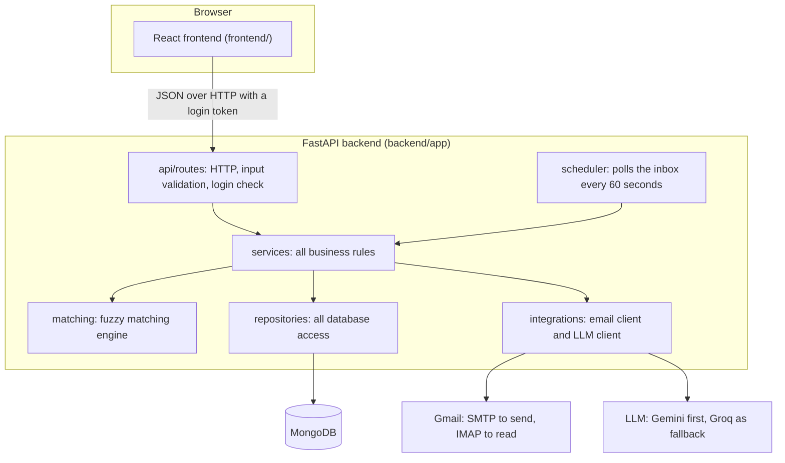
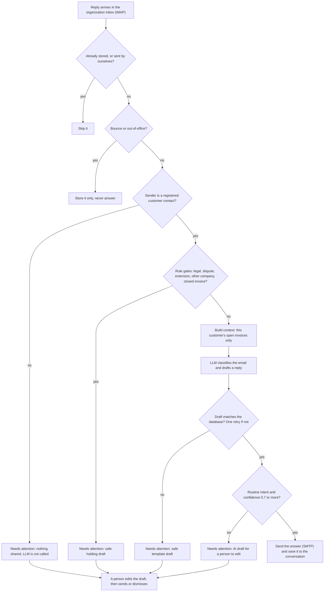
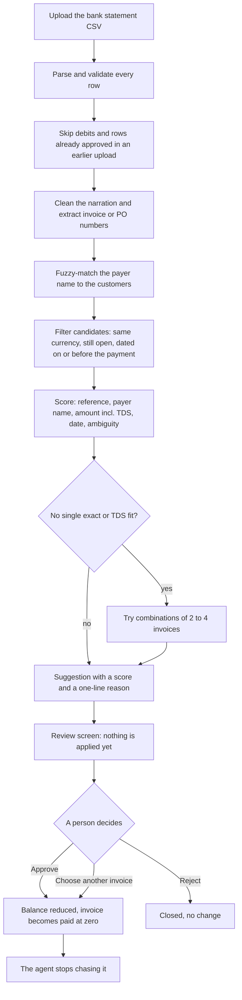
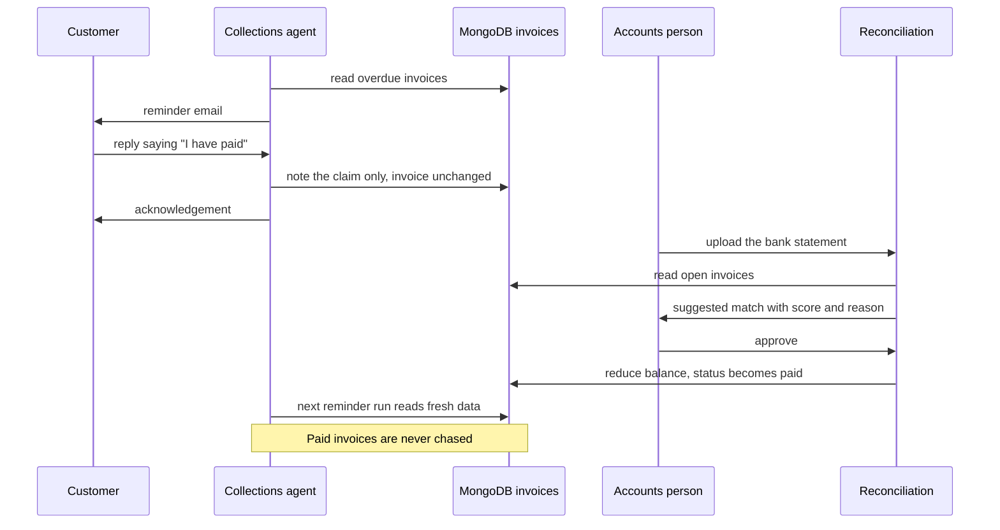

# AcmeCorp Collections Agent and Bank Reconciliation

A complete application for the Accounts Team of a fictional company, AcmeCorp. It handles the two steps that come after an invoice is sent:

1. **Collections.** It emails customers about overdue invoices, reads their replies, answers routine questions automatically with an LLM, and sends anything risky to a person.
2. **Bank reconciliation.** It reads a bank statement CSV, suggests which invoice each payment belongs to (with a confidence score and a reason), and lets a person approve, reject or change each suggestion. An approved payment updates the invoice, and the agent stops chasing it.

**A person always decides anything that needs judgement.** The software suggests, and nothing is applied to an invoice until someone approves it. A customer saying "I have paid" is only noted, never trusted.

---

## Contents

1. [What is built](#1-what-is-built)
2. [Architecture](#2-architecture)
3. [Project structure](#3-project-structure)
4. [Tech stack](#4-tech-stack)
5. [Setup](#5-setup)
6. [Configuration reference](#6-configuration-reference)
7. [Using the app](#7-using-the-app)
8. [API reference](#8-api-reference)
9. [How bank matching works](#9-how-bank-matching-works)
10. [How the collections agent decides](#10-how-the-collections-agent-decides)
11. [Security](#11-security)
12. [Design decisions and assumptions](#12-design-decisions-and-assumptions)
13. [Testing](#13-testing)
14. [Honest status and limitations](#14-honest-status-and-limitations)
15. [Troubleshooting](#15-troubleshooting)

---

## 1. What is built

| Area | Status |
|---|---|
| **Part A: base app.** Organization, customers and invoices pages. Overdue flag and unpaid amount per invoice. Editable customer email. **Reset demo data** button. | Done |
| **Part B: collections agent.** SMTP reminders, IMAP reading (automatic polling and a **Check inbox now** button), threading to customer and conversation, LLM answers, validation of every figure, **Needs attention** list with editable drafts. | Done |
| **Part C: bank reconciliation.** CSV upload, local fuzzy matching with score and reason, approve, reject or choose another invoice, TDS choice (close invoice or leave balance open), balance updates, invoice becomes paid at zero. | Done |
| **Bonus: one payment covering several invoices.** The combination is suggested and the payment is split on approval. | Done |
| **Bonus: out-of-office and bounced emails.** They are recognized, stored, and never answered. | Done |
| **Bonus: link a payment email to its bank row.** | Not built (see [limitations](#14-honest-status-and-limitations)) |

---

## 2. Architecture

### 2.1 The big picture

The system has three parts: a **React frontend**, a **FastAPI backend**, and **MongoDB**. The backend also talks to two outside services, Gmail (email) and an LLM provider.



The same idea as plain text:

```
 Browser (React)
      |  JSON + login token (the only way in)
      v
 api/routes ---------- validates input, checks login, no business logic
      v
 services ------------ the rules: overdue, reminders, agent decisions, approvals
   |     |      |
   |     |      +--> integrations --> Gmail (SMTP/IMAP), LLM (Gemini -> Groq)
   |     +---------> matching ------> fuzzy matching of bank rows to invoices
   v
 repositories -------- the only code that touches the database
      v
   MongoDB
```

### 2.2 The layering rule

Each layer may only call the layer below it. This keeps the code easy to follow and easy to change.

| Layer | Folder | Job | May call |
|---|---|---|---|
| Frontend | `frontend/` | Shows data and sends the person's decisions. Holds no secrets and never touches the database, mail server or LLM. | The API only |
| Routes | `backend/app/api/routes/` | Receives HTTP requests, validates the input, checks the login, calls a service. Contains no business logic. | Services |
| Services | `backend/app/services/` | All the rules: what is overdue, what a reminder says, how the agent decides, how an approval changes an invoice. | Repositories, matching, integrations |
| Matching | `backend/app/matching/` | Pure functions that match bank rows to invoices. No database, no network. | Nothing |
| Integrations | `backend/app/integrations/` | The only code that talks to Gmail and the LLM providers. | Outside services |
| Repositories | `backend/app/repositories/` | The only code that reads or writes MongoDB. Queries only, no rules. | MongoDB |
| Core | `backend/app/core/` | Settings, database connection, login security, error type, clock. | Used by all layers |

### 2.3 Workflow 1: how a customer's email is handled

This is the path of every reply that arrives in the organization's inbox. The key idea: **code decides whether the AI is allowed to answer at all, and code checks the AI's answer before anything is sent.**



Reminders (the outgoing side) are simpler: the scheduler or a button asks the database for overdue invoices, fills a **fixed template** (no LLM, so no wrong figures), sends one email per customer, and stores it in that customer's conversation.

### 2.4 Workflow 2: how a bank statement is reconciled



### 2.5 How the two workflows connect

The two workflows never call each other. They connect through **one shared fact: the invoice record in MongoDB.**



Because overdue is **computed from the database every time** (status is `sent`, a balance remains, and the due date has passed), there is no copy to go stale. An approved payment takes effect for the agent immediately, with no extra step.

### 2.5.1 Approving a payment safely

Approval changes money records, so it is written defensively:

- **Atomic claim.** The transaction is claimed in one database call, so a double click or two open tabs cannot apply it twice.
- **Optimistic check.** An invoice is updated only if its balance is still what was read a moment ago. Otherwise the request fails with a clear message and nothing changes.
- **Undo on failure.** If a multi-invoice split fails halfway, the invoices already changed are restored.
- **Duplicate protection.** Each bank row gets a fingerprint (date, amount, currency, reference). A row approved once is skipped if the same statement is uploaded again.

### 2.6 Data model (MongoDB collections)

| Collection | Holds | Written by |
|---|---|---|
| `organization` | AcmeCorp details, bank details, policies (1 document) | seed |
| `customers` | The 9 customers. `contact_email` is editable. | seed, email edit |
| `invoices` | The 27 invoices. After a TDS close, an extra `tds_deducted` field is added. | seed, approvals |
| `conversations` | One rolling conversation per customer, plus one per unknown sender. Holds payment claims and flags. | agent |
| `messages` | Every email: reminders, customer replies, automatic answers, manual replies, bounces. Flagged ones carry an `attention` block (reason, draft, status). | agent |
| `bank_transactions` | One document per statement row, with the suggestion, score, reason and review status. A "batch" is the set of rows sharing a `batch_id`. | reconciliation |
| `payments` | One document per invoice that an approved payment was applied to. | approvals |

**Reset demo data** drops all of these and reloads the three JSON files, which also clears conversations, messages, bank transactions and payments.

---

## 3. Project structure

```
acme-collections/
├── README.md                    This file
├── explanation.pdf              Short written explanation (algorithms, architecture, decisions)
├── .gitignore                   Keeps .env, venv, node_modules and dist out of git
├── data/                        The provided test data, used as given
│   ├── organization.json
│   ├── customers.json
│   ├── invoices.json
│   ├── bank_statement_sample.csv
│   └── data-explanation.md
├── backend/
│   ├── requirements.txt
│   ├── .env.example             Placeholders for every setting (no real secrets)
│   ├── app/
│   │   ├── main.py              Creates the app, registers routes, login guard, scheduler
│   │   ├── api/routes/
│   │   │   ├── organization.py  GET organization
│   │   │   ├── customers.py     List customers, edit a customer's email
│   │   │   ├── invoices.py      List and read invoices (with overdue info)
│   │   │   ├── reconciliation.py  Upload statement, approve, reject, list
│   │   │   ├── agent.py         Login, reminders, inbox check, conversations, Needs attention
│   │   │   └── admin.py         Reset demo data
│   │   ├── services/
│   │   │   ├── seed_service.py          Loads (or reloads) the JSON data
│   │   │   ├── invoice_service.py       Overdue and unpaid calculation
│   │   │   ├── customer_service.py      Customer totals
│   │   │   ├── reconciliation_service.py  Upload, approve and reject rules
│   │   │   ├── collections_service.py   Reminder template, safe drafts, rule gates, draft validator
│   │   │   └── agent_service.py         Reminders, inbox processing, decisions, scheduler
│   │   ├── matching/
│   │   │   ├── text_utils.py    Text cleaning, invoice-number extraction, name similarity
│   │   │   └── engine.py        CSV parsing, scoring, TDS, combinations, statement matching
│   │   ├── integrations/
│   │   │   ├── email_client.py  Send with SMTP, read with IMAP, parse, detect bounces
│   │   │   └── llm_client.py    LangChain: Gemini with Groq fallback, structured output
│   │   ├── repositories/
│   │   │   ├── organization_repo.py
│   │   │   ├── customer_repo.py
│   │   │   ├── invoice_repo.py
│   │   │   ├── reconciliation_repo.py   Transactions, payments, invoice updates
│   │   │   └── collections_repo.py      Conversations and messages
│   │   ├── schemas/
│   │   │   └── customer.py      Request model for the email edit
│   │   └── core/
│   │       ├── config.py        Settings read from .env
│   │       ├── database.py      The MongoDB connection
│   │       ├── security.py      Login, tokens, rate limit
│   │       ├── errors.py        One error type used by every service
│   │       └── clock.py         "Today", which can be pinned for testing
│   ├── scripts/
│   │   ├── seed.py              Load the data: python -m scripts.seed
│   │   └── try_match.py         Print the matching result for the sample CSV
│   └── tests/
│       ├── test_matching.py     The 14 sample rows plus edge cases
│       └── test_collections.py  Formatting, draft validation, safety rules, email parsing
└── frontend/
    ├── package.json  vite.config.js  index.html  .env.example
    └── src/
        ├── main.jsx             Starts React
        ├── App.jsx              Login, tabs, Reset demo data
        ├── shared.jsx           API client, money and date formatting, small components
        ├── styles.css
        └── pages/
            ├── Base.jsx         Organization, Customers, Invoices
            ├── Collections.jsx  Actions, Needs attention, Conversations
            └── Reconciliation.jsx  Upload, review table, approve or reject
```

### What each folder does, in one line

| Folder | Summary |
|---|---|
| `backend/app/api/routes` | Handles HTTP requests: validates the input, checks the login, and calls a service. |
| `backend/app/services` | Holds the business rules and decides what happens. |
| `backend/app/matching` | Matches bank statement rows to invoices using local algorithms. No database, no network. |
| `backend/app/integrations` | Talks to the outside world: Gmail and the LLM providers. |
| `backend/app/repositories` | Handles all interaction with the data: the only code that reads or writes MongoDB. |
| `backend/app/schemas` | Describes the shape of request bodies. |
| `backend/app/core` | Shared basics: settings, database connection, login security, errors, clock. |
| `backend/scripts` | Command-line helpers: load the data, try the matching. |
| `backend/tests` | Automated tests that need no database, Gmail or LLM. |
| `frontend/src/pages` | The screens. Each page loads data through the API and shows it. |
| `data` | The provided fictional test data. |

---

## 4. Tech stack

| Part | Choice | Why |
|---|---|---|
| Backend | **FastAPI** (Python) | Automatic input validation and interactive API docs at `/docs`. |
| Database | **MongoDB** (via `pymongo`) | NoSQL, as required. Invoices, messages and transactions are naturally documents. |
| Frontend | **React + Vite** | A separate app that talks to the backend only through the API. |
| Matching | **rapidfuzz** + plain Python | Token set ratio and Jaro-Winkler for fuzzy text, exact arithmetic for amounts and TDS. |
| LLM | **LangChain** with **Gemini**, falling back to **Groq** | One small wrapper; structured output; automatic fallback if the first provider fails. |
| Email | `smtplib` and `imaplib` (Python standard library) | No extra dependency; works with any SMTP/IMAP server. |
| Scheduling | **APScheduler** | Background inbox polling inside the same process. |
| Login | **PyJWT** | Signed, expiring tokens. |

---

## 5. Setup

### 5.1 Prerequisites

| Need | Notes |
|---|---|
| **Python 3.10 or newer** | Check with `python --version`. |
| **Node.js 18 or newer** | Check with `node -v`. |
| **MongoDB** | Local install (Community Server) or Docker: `docker run -d --name mongo -p 27017:27017 mongo:7`. A MongoDB Atlas connection string also works. |
| **Two Gmail accounts** | One for the organization (sends and reads), one that acts as a customer. Use new accounts made for this project. |
| **An LLM API key** | A free Gemini key (Google AI Studio) and/or a free Groq key. At least one. |

### 5.2 Prepare the Gmail accounts

Only the **organization** account needs special setup:

1. Turn on **2-Step Verification** for the account.
2. Create an **App Password** (Google Account, Security, App passwords). Gmail refuses the normal password over SMTP and IMAP.
3. Make sure IMAP is enabled in Gmail settings, if the option is shown.

The customer account needs nothing. You simply reply from it by hand.

### 5.3 Prepare the data (one line)

In `data/organization.json`, set `accounts_email` to the organization's inbox address. The data files are otherwise used exactly as given.

### 5.4 Run the backend

```bash
cd backend
python -m venv venv

# Windows
venv\Scripts\activate
# macOS / Linux
source venv/bin/activate

pip install -r requirements.txt
```

Create your settings file and fill it in (see the [configuration reference](#6-configuration-reference)):

```bash
# Windows
copy .env.example .env
# macOS / Linux
cp .env.example .env
```

The settings you must fill in:

```
ADMIN_PASSWORD=choose-a-password
JWT_SECRET=<a long random string>
ORG_EMAIL=organization-account@gmail.com
ORG_EMAIL_PASSWORD=<the Gmail app password>
GEMINI_API_KEY=<your key>        # and/or GROQ_API_KEY
```

Generate a `JWT_SECRET` with:

```bash
python -c "import secrets; print(secrets.token_urlsafe(32))"
```

Load the data and start the server (MongoDB must be running):

```bash
python -m scripts.seed        # prints {'organization': 1, 'customers': 9, 'invoices': 27}
uvicorn app.main:app --reload
```

The API is now on `http://localhost:8000`, with interactive docs at `http://localhost:8000/docs`.

### 5.5 Run the frontend

In a second terminal:

```bash
cd frontend
npm install
npm run dev
```

Open **http://localhost:5173** and log in with `ADMIN_USERNAME` (default `admin`) and your `ADMIN_PASSWORD`.

If the backend is not on `http://localhost:8000`, copy `frontend/.env.example` to `frontend/.env` and change `VITE_API_URL`. If the frontend is not on port 5173, add its address to the backend `.env`, for example `CORS_ORIGINS=["http://localhost:3000"]`.

---

## 6. Configuration reference

All settings live in `backend/.env`. The file is never committed; `backend/.env.example` lists every setting with a placeholder.

| Variable | Required | Default | Meaning |
|---|---|---|---|
| `MONGO_URI` | no | `mongodb://localhost:27017` | MongoDB connection string |
| `MONGO_DB` | no | `acmecorp` | Database name |
| `TODAY` | no | empty (real date) | Pin "today" for overdue calculations, e.g. `2026-11-05` |
| `ADMIN_USERNAME` | no | `admin` | Login name |
| `ADMIN_PASSWORD` | **yes** | empty | Login password. The API refuses to run open if it is empty. |
| `JWT_SECRET` | **yes** | empty | Signs login tokens. Must be 16+ characters. |
| `JWT_HOURS` | no | `8` | Login lifetime |
| `ORG_EMAIL` | **yes** | empty | The organization mailbox (sends and reads) |
| `ORG_EMAIL_PASSWORD` | **yes** | empty | Gmail App Password for that mailbox |
| `SMTP_HOST` / `SMTP_PORT` | no | `smtp.gmail.com` / `465` | Sending server (465 uses SSL, other ports use STARTTLS) |
| `IMAP_HOST` / `IMAP_PORT` | no | `imap.gmail.com` / `993` | Reading server |
| `EMAIL_DRY_RUN` | no | `false` | `true` logs emails instead of sending them |
| `IMAP_POLL_SECONDS` | no | `60` | Automatic inbox check interval (`0` turns it off) |
| `AUTO_REMINDERS` | no | `false` | Send reminders automatically on a schedule |
| `REMINDER_INTERVAL_HOURS` | no | `24` | How often the automatic reminder job runs |
| `REMINDER_COOLDOWN_DAYS` | no | `3` | Minimum gap between reminders to the same customer |
| `GEMINI_API_KEY` | one LLM key is required | empty | Google Gemini key |
| `GEMINI_MODEL` | no | `gemini-flash-latest` | Gemini model name. If you get "model not found", copy a current free model name from Google AI Studio. |
| `GROQ_API_KEY` | one LLM key is required | empty | Groq key (used as the fallback, or alone) |
| `GROQ_MODEL` | no | `openai/gpt-oss-120b` | Groq model name |
| `CORS_ORIGINS` | no | `["http://localhost:5173"]` | Allowed frontend addresses (JSON list) |

Model names are settings because providers retire models. For example, Groq shut down `llama-3.3-70b-versatile` for free and developer tiers in August 2026. If both keys are set, Gemini is tried first and Groq takes over if it fails.

---

## 7. Using the app

### 7.1 First run

1. **Log in.**
2. Open **Customers**. Change one customer's email (for example Kestrel Foods) to the customer test inbox and press **Save**. Do this before sending reminders: the other customers still have `example.com` addresses that cannot receive mail.
3. Open **Collections**. Choose that customer in the dropdown and press **Remind now**. The reminder arrives in the customer inbox.
4. Reply from the customer inbox with one of the messages below.
5. Press **Check inbox now** (or wait up to 60 seconds). Open **Conversations** and **Needs attention**.
6. Open **Bank reconciliation**, upload `data/bank_statement_sample.csv`, and review the suggestions.

**Reset demo data** (top right) restores the original data and clears conversations, bank transactions and payments. Customer emails return to the `example.com` originals, so enter your test address again afterwards.

### 7.2 Try these customer replies

| The customer writes | What happens |
|---|---|
| "Is this the only amount pending from us? Also please send your bank details." | Answered automatically: the open invoices, the total, and the bank details |
| "We paid INV-1004 yesterday, reference N123456789" | Acknowledged automatically. The claim is noted on the conversation. **The invoice stays unpaid.** |
| "Can we have two more weeks?" | **Needs attention**, with a holding draft. Nothing is agreed. |
| "We will take legal action" or "We dispute this invoice" | **Needs attention** |
| "What does Quillon Technologies owe you?" | **Needs attention**. Nothing about another company is shared. |
| An email from any address that is not a registered contact | **Needs attention**. No account data is shared and the LLM is not called. |
| A Gmail out-of-office auto-reply | Stored and ignored, never answered |

### 7.3 What the sample bank statement should produce

| Statement row | Expected suggestion |
|---|---|
| Kestrel, `INV 1004`, ₹59,000 | INV-1004, high confidence (INV-1005 has the same amount but is dated after the payment) |
| Orbis `PART PAYMENT`, ₹2,00,000 | INV-1013, leave balance open |
| Quillon, ₹3,24,000 | INV-1007, close invoice (TDS ₹30,000) |
| Nordlys `RE 1024`, €9,200 | INV-1024 |
| Harbour `INV1021`, $12,500 | INV-1021 |
| Brightline `INV-1002`, ₹2,36,000 | INV-1002 |
| Redwood Clinic, ₹59,000 | INV-1016 |
| Thornfield, £7,350.50 | INV-1026 |
| Saffron Peak `OCT DUES`, ₹1,94,700 | INV-1010 + INV-1011 + INV-1012 (split) |
| R K Sharma `CLINIC DUES`, ₹88,500 | INV-1017 with **low** confidence (payer not recognized, matched on amount only) |
| Maple Retail, ₹12,750 | No match |
| Bank interest | No match |
| The two debit rows | Ignored |

---

## 8. API reference

Base URL `http://localhost:8000`. Interactive docs with request builders are at `/docs`. Every endpoint except `/health` and `/api/auth/login` needs the header `Authorization: Bearer <token>`.

### Auth and system

| Method | Path | Purpose |
|---|---|---|
| POST | `/api/auth/login` | Body `{"username", "password"}`. Returns `{"access_token", "token_type", "expires_in"}`. |
| GET | `/health` | Checks the server and the database. No login needed. |
| POST | `/api/admin/reset` | Restores the original data and clears conversations, bank transactions and payments. |

### Organization, customers, invoices

| Method | Path | Purpose |
|---|---|---|
| GET | `/api/organization` | AcmeCorp details, bank details, policies |
| GET | `/api/customers` | All customers, each with `outstanding`, `overdue_invoices`, `overdue_amount` |
| GET | `/api/customers/{customer_id}` | One customer |
| PATCH | `/api/customers/{customer_id}/email` | Body `{"contact_email"}`. Validated as an email address. |
| GET | `/api/invoices` | Query filters: `customer_id`, `status` (`draft`, `sent`, `paid`), `overdue` (`true` or `false`). Each invoice includes `amount_owed`, `is_overdue`, `days_overdue`. |
| GET | `/api/invoices/{invoice_number}` | One invoice |

### Collections agent

| Method | Path | Purpose |
|---|---|---|
| POST | `/api/collections/reminders` | Body (optional) `{"customer_id", "force"}`. Sends reminders for overdue invoices. Customers reminded within the cooldown are skipped unless `force` is true. |
| POST | `/api/collections/inbox/check` | Reads new emails and processes them. Returns counts of automatic answers, attention items, ignored and duplicates. |
| GET | `/api/collections/conversations` | All conversations |
| GET | `/api/collections/conversations/{conversation_id}` | One conversation with all its messages and payment claims |
| GET | `/api/collections/attention` | Emails waiting for a person, with the reason and a draft reply |
| POST | `/api/collections/attention/{item_id}/send` | Body `{"body", "confirm"}`. Sends the (edited) reply to the original sender. If figures do not match the records, it returns 409 until `confirm` is true. |
| POST | `/api/collections/attention/{item_id}/dismiss` | Closes an item without replying |

### Bank reconciliation

| Method | Path | Purpose |
|---|---|---|
| POST | `/api/reconciliation/upload` | Multipart form with a `file` (CSV, up to 1 MB). Returns the batch with a suggestion for each row. Nothing is applied. |
| GET | `/api/reconciliation/batches` | Previous uploads with status counts |
| GET | `/api/reconciliation/batches/{batch_id}` | One upload with all its rows |
| POST | `/api/reconciliation/transactions/{txn_id}/approve` | Body (optional) `{"invoice_numbers": [...], "action": "close_tds" or "leave_open"}`. With no body, the suggestion is approved. |
| POST | `/api/reconciliation/transactions/{txn_id}/reject` | Body (optional) `{"note"}` |
| GET | `/api/reconciliation/payments` | Payments applied to invoices |

Errors come back as `{"detail": "message"}` with a meaningful status: 400 bad input, 401 not logged in, 404 not found, 409 conflict (already decided, or changed meanwhile), 413 file too large, 429 too many logins, 502 email or inbox failure, 503 not configured.

---

## 9. How bank matching works

The matching is **local code, not an LLM**. It lives in `backend/app/matching/` as pure functions, so it is fast, repeatable and testable.

### 9.1 Steps for each statement row

1. **Parse.** Read the CSV, check the columns, and reject bad dates or amounts with the row number. Only credits are candidates. Debits are ignored.
2. **Clean.** Uppercase the narration and remove transfer words (`NEFT`, `UPI`, `CR`), legal suffixes (`PVT`, `LTD`, `LLP`), months and filler words.
3. **Extract references.** A regex finds invoice numbers in every spelling: `INV-1002`, `INV 1004`, `INV1021`, `RE 1024`. A PO number from an invoice is also recognized.
4. **Identify the payer.** Compare the cleaned name to each customer (see 9.2).
5. **Filter candidates (hard rules).** An invoice is a candidate only if it is `sent`, has a balance, is in the **same currency**, and is dated **on or before the payment**. This removes impossible matches, for example an invoice created after the money arrived.
6. **Score** each candidate (see 9.3).
7. **Combinations.** If no single invoice fits exactly (or exactly after TDS), try every group of 2 to 4 open invoices of that customer whose balances add up to the payment.
8. **Output** the invoice(s), a score from 0 to 99, a one-line reason, and a suggested action. When unsure, the result is "no match".

### 9.2 Name matching

A bank narration is short, truncated and abbreviated (`ORBIS PKG` for Orbis Packaging, `REDWOOD CLINIC` for Redwood Clinics). Two signals are combined 50/50:

- **Token set ratio** (rapidfuzz): compares the sets of words, so word order and extra words do not matter.
- **Coverage:** the share of narration words that match some word of the customer name. A word matches if it is equal, a prefix (`HOSP` for `HOSPITALITY`), an abbreviation whose letters appear in order (`PKG` for `PACKAGING`), or has a Jaro-Winkler similarity of at least 0.9 (typos).

A score of 0.6 or more means the payer is recognized.

Not used, on purpose: **Levenshtein** (it punishes length differences, so abbreviations look unrelated) and **sentence embeddings** (a large model download for little gain when matching against nine known names).

### 9.3 Scoring

| Evidence | Points |
|---|---|
| Invoice or PO number found in the narration | 40 |
| Payer name | up to 35 (only up to 12 if the payer is not recognized) |
| Amount equals the balance | 35 |
| Amount equals the balance minus 10% TDS | 33 |
| Amount is less than the balance (part payment) | 12 |
| Date gap of 90 days or less | 5 |
| Clear winner over the runner-up (by 20 points or more) | +15 |
| Runner-up is very close (under 10 points) | -15, and the reason says "also fits INV-xxxx" |

Safety caps keep weak evidence from looking strong: a payment above the balance is capped at 50, an invoice number with a mismatched payer at 60, and a payer that is not recognized (matched on a unique amount only) at 50 or less. Confidence is **high** at 80 or more, **medium** at 55 to 79, and **low** below that.

### 9.4 TDS and part payments

An Indian customer may pay 10% of the invoice **subtotal** less than the total and send that amount to the government. If a payment equals the balance minus 10% of the subtotal, it is flagged as TDS. For discounted invoices, 10% of the subtotal after discount is also accepted. When a payment is less than the invoice, the person chooses **Close invoice (TDS deducted)** or **Leave balance open**. Closing as TDS is allowed only for INR invoices, and only if the shortfall is at most 10% of the subtotal.

### 9.5 Inside one statement

If a row claims an invoice, later rows in the same statement cannot claim it again, so a duplicated payment row does not match the same invoice twice.

---

## 10. How the collections agent decides

### 10.1 Reminders

Built from a **fixed template**, never from the LLM. Each email lists the customer's overdue invoices (number, amount, due date, days overdue), the total, and the payment details that suit the customer: NEFT, RTGS, IMPS or UPI with the IFSC for India; SWIFT (or SEPA for EUR) with the SWIFT code abroad, with a note that international customers cover their own bank charges. Amounts use each currency's format (₹1,18,000.00, $12,500.00, €9,200.00, £7,350.50) and dates read like "19 September 2026".

### 10.2 Replies

| The customer... | The agent... |
|---|---|
| Asks about balance, invoices or how to pay | Answers automatically, using only sent, unpaid invoices |
| Says they have paid, or will pay on a date | Acknowledges and **notes** it. It never marks anything as paid. |
| Asks for more time, disputes, or mentions legal action | Agrees to nothing and moves it to **Needs attention** |
| Asks about another company, or is an unknown sender | Shares nothing and moves it to **Needs attention** |

### 10.3 Safeguards

- **The code, not the AI, decides what the AI may answer.** Keyword rules catch legal, dispute, extension, discount and waiver wording, other companies' names, other companies' invoice numbers, and invoices that are not open. Those go to a person without an LLM call.
- **Only this customer's data reaches the LLM:** the organization's details and policies, and this customer's open invoices with pre-formatted amounts and dates. Other customers' data is never in the prompt. Unknown senders never reach the LLM at all.
- **Every draft is validated against the database before sending.** Invoice numbers must be this customer's open invoices. Every amount must be an invoice balance, a total, or a TDS figure, in the customer's currency. Every date must be a due date, an invoice date or today. Account numbers and IFSC codes must be AcmeCorp's, every email address must be a known one, and no other customer may be named. A failed draft is retried once, with generic feedback that never names other customers. If it still fails, a person gets a safe template draft.
- **Only routine intents with confidence of at least 0.7 are sent automatically.** Everything else goes to Needs attention.
- **Prompt injection.** The email is passed as untrusted data inside tags, the system prompt tells the model to ignore instructions in it, and the output validator is the real safeguard.
- **Loop protection.** Automatic replies are never sent to bounces or out-of-office messages, mail from the organization's own address is ignored, and at most 5 automatic replies are sent per conversation per hour.
- **If the AI is down,** the email still lands in Needs attention with a correct template draft, so nothing is lost.
- **Manual replies** go only to the original sender. If an edited reply contains figures that do not match the records, the API asks for confirmation first, because the Accounts Team is allowed to offer things such as a new payment date.

---

## 11. Security

- **Secrets** live only in `backend/.env`, which is git-ignored. `.env.example` has placeholders only.
- **Login.** Every API route except `/health` and `/api/auth/login` requires a signed, expiring token. The server refuses to run with no password or a weak `JWT_SECRET`. Credentials are compared in constant time, and 5 failed logins in a minute from one address are blocked.
- **Input validation** on every endpoint through Pydantic. Email addresses, invoice numbers, customer IDs and the allowed action values are checked, and bodies have length limits. Request values are only ever used as plain strings in database queries, which blocks NoSQL injection.
- **Uploads.** CSV only, 1 MB maximum, UTF-8, at most 2000 rows, and only the base file name is kept.
- **One customer never sees another's data.** The LLM context holds one customer's data only, senders are verified against the registered contact address, and every draft is checked for other customers' names and invoice numbers.
- **Email safety.** Header injection is rejected, replies go only to addresses already in the conversation, and the app never returns passwords or tokens in errors or logs.
- **Browser.** CORS allows only the configured frontend origin. Responses carry `X-Content-Type-Options`, `X-Frame-Options: DENY` and `Cache-Control: no-store`. The frontend never renders raw HTML (React escapes all text, including email bodies), keeps no secrets, and stores its login token in `sessionStorage`, so it clears when the tab closes.
- **Money safety.** Approvals are atomic, checked against the current balance, undone on failure, and protected against duplicates.

---

## 12. Design decisions and assumptions

- **MongoDB is the single source of truth.** There is no cache. With about 27 invoices a cache adds nothing, and a second copy of the data could show a paid invoice as overdue.
- **"Overdue" is computed, never stored,** from the status, the balance, and today's date. Draft invoices are never chased and never shown to customers.
- **No currency conversion.** Each customer is billed in one currency. Matching and totals stay within a currency.
- **A customer's "I paid" is only a note.** Only an approved bank transaction changes an invoice.
- **One rolling conversation per customer,** plus one conversation per unknown sender address. If several customers share one email address, the reply thread headers decide which customer it is. If that cannot be decided, it goes to Needs attention.
- **TDS** is 10% of the invoice subtotal, as in the policy. For discounted invoices, 10% of the discounted subtotal is also accepted when matching.
- **A payment dated before its invoice is never matched automatically.** A person can still choose such an invoice manually.
- **A partial payment applies to one invoice.** A split must add up exactly to the payment.
- **Approval is final.** A decided transaction cannot be reopened.
- **Reset restores the original customer emails,** as the assignment asks. Re-enter your test addresses afterwards.
- **The LLM is used only for understanding replies and drafting.** Bank matching, amounts, dates and approvals are all code.
- **LLM models are configurable,** since providers retire models.

---

## 13. Testing

The automated tests need no database, Gmail or LLM:

```bash
cd backend
python -m pytest tests -q        # 42 passed
python -m scripts.try_match      # prints the matching result for the sample CSV (needs MongoDB with seeded data)
```

- `tests/test_matching.py` checks every one of the 14 sample statement rows (invoice, action and confidence level), plus ambiguous amounts, reuse of an invoice by a second row, and malformed CSV files.
- `tests/test_collections.py` checks money and date formatting (including Indian digit grouping), the draft validator (it must accept a correct draft and reject wrong amounts, dates, invoices, currencies, bank details, unknown email addresses and other customers), the rule gates for risky emails, and email parsing (quoted text removal, out-of-office and bounce detection).

The full email flow (reminders, replies, Needs attention) was checked with two real Gmail accounts and the live LLM, and the whole API flow was also exercised with simulated emails and a simulated LLM.

---

## 14. Honest status and limitations

**Built and working:** Parts A, B and C, plus two bonus items (multi-invoice split, bounce and out-of-office handling).

**Not built:**
- **Linking a customer's payment email to its bank row.** Payment claims are stored and shown on the conversation, but they are not attached to bank statement rows or used as extra matching evidence.
- **Attachments.** Only the plain-text content of emails is read.

**Known limits:**
- Combination matching covers exact sums of 2 to 4 invoices of one customer, and does not combine with TDS.
- TDS handling applies to INR invoices with nothing paid yet.
- The scoring weights and the 80 and 55 confidence thresholds were tuned by hand on the sample statement. They are explained in section 9.3 and are easy to change in `matching/engine.py`.
- Login is a single Accounts Team account configured in `.env`. There are no user accounts or roles.
- The inbox poller runs inside the API process. For heavy use it would move to a separate worker with a job queue.
- Free LLM tiers have rate limits. If both providers fail, emails go to Needs attention with a correct template draft.

---

## 15. Troubleshooting

| Problem | Likely cause and fix |
|---|---|
| `Could not read the inbox` or `Could not send the email` | The Gmail App Password is wrong, 2-Step Verification is off, or IMAP is disabled. Check `ORG_EMAIL` and `ORG_EMAIL_PASSWORD`. |
| `Email is not configured` | `ORG_EMAIL` or `ORG_EMAIL_PASSWORD` is empty in `.env`. |
| `Login is not configured` (503) | `ADMIN_PASSWORD` is empty or `JWT_SECRET` is shorter than 16 characters. |
| `AI unavailable` in Needs attention | A bad API key, an unknown model name, or a rate limit. The email still has a safe draft. Check `GEMINI_API_KEY`, `GROQ_API_KEY` and the model names. |
| Frontend shows "Cannot reach the server" | The backend is not running, or `VITE_API_URL` is wrong. |
| Browser shows a CORS error | Add the frontend's address to `CORS_ORIGINS` in `backend/.env`, then restart the backend. |
| Every request returns 401 | The login expired. Log in again. |
| Bounce messages appear in the inbox | A reminder was sent to a customer that still has an `example.com` address. Edit the email first. |
| Reminders are skipped | The customer was reminded within `REMINDER_COOLDOWN_DAYS`. Use **Remind now** (it overrides the cooldown). |
| `ImportError` when starting the backend | A file was pasted incompletely, or `pip install -r requirements.txt` was not run inside the virtual environment. |
